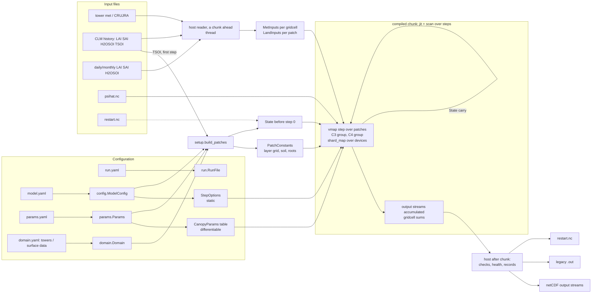
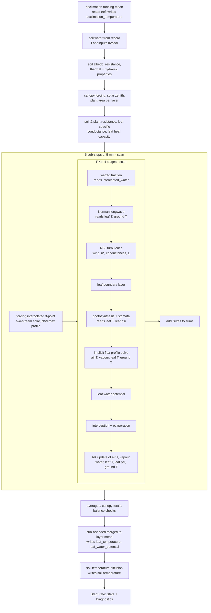

# How CLM-ML-JAX works (after Phase 7)

Written from the code at `3370570` (branch `phase8a/housekeeping`), not from the plan.
Paths are relative to `src/clm_ml/`. "P" = patches, "G" = gridcells, "L" = `max_layers`
(50), "S" = soil levels (`nlevgrnd` = 25; `nlevsoi` = 20 hydrologically active).

---

## 1. Configuration: an experiment folder of four files -> Python objects

An experiment is a folder with four complete files (decision 91,
[`experiment_folders.md`](experiment_folders.md)), loaded by
`experiment.load_experiment` into `experiment.Experiment`:

| File | Says | Loaded into | What kind of value |
|---|---|---|---|
| `run.yaml` | when and with what: dates, calendar, forcing files (and the tower data interval), land-data sources, initial conditions, output streams, chunks, restarts, devices | `run.RunFile` (`TimeSection`, `ForcingSection`, `InitialConditionsSection`, `OutputSection`, `ExecutionSection`) | **host bookkeeping and data** (file names, dates). Run length and chunk length are host-side; the forcing they select is data |
| `domain.yaml` | where: towers (location, forcing height, soil: texture, sand/clay, organic matter, colour, bedrock; patches: PFT, weight, canopy height, root biomass, beta profiles, optional layer counts) or a grid (`grid.GridSection`: CLM surface dataset, land mask, region) | `domain.DomainFile` -> `domain.Domain` (gridcells, patches, soil columns) | **data used at setup** (become `PatchConstants`) |
| `model.yaml` | `processes` (each process's parameterization), numerics (including the model step), canopy layers, soil | `config.ModelConfig` -> `options.MLOptions` -> `step.StepOptions` + `canopy.SubstepOptions` (`driver.step_options`) | **static**: changing any of them recompiles; none is differentiable |
| `params.yaml` | every parameter of every PFT 1-16 | `params.Params` (specs in `PARAM_SPECS`) -> `params.CanopyParams` (25 fields), one row per PFT in the domain | **differentiable** (gradients come back per PFT), except the few read at setup (below) |

Every option is declared once in the code (`yaml_schema.option`: explanation, Fortran name,
the kind of run it applies to, hidden test settings, paths); `clm-ml new` writes the files
from a compset (`src/clm_ml/compsets/`: tower, params and experiment compsets), and `configs/`
holds the compsets written out. `src/clm_ml/data/psihat.nc` is the only file the processes read
from the package.

Three kinds of "value" (the JAX distinction):
- **static** (code path, array sizes): model.yaml options, `max_layers`, C3/C4 (per group),
  step/sub-step lengths, number of steps in a chunk, output stream definitions.
- **data** (any value, same compiled program): forcing, land data, `PatchConstants`, weights,
  psihat tables, initial state.
- **differentiable**: anything that is data *and* a JAX array in the compiled chunk: PFT
  parameters, state, forcing, weights, constants, tables.

---

## 2. Inputs

### 2a. Meteorological forcing (per gridcell, per step)
Towers: tower netCDF files (`ZBOT TBOT RH/QBOT UBOT FSDS (or FSDS_DIRECT/DIFFUSE) FLDS PBOT
PRECTmms`), read by `io/tower.py` (`TowerMetRaw`, `derive_tower_met` `io/tower.py:321`: shortwave
split into direct/diffuse × vis/nir, q from RH, missing longwave/pressure filled, CO2 383 ppm,
O2 = 0.209·P) in `tower_forcing.TowerForcingSource` (chunk by chunk; interpolated on the host to
the model step if it is shorter than the data interval: `forcing_interpolation.py`).
Grid: CRUJRA `TPQW`/`Precip`/`Solar` streams + CO2 time series, mapped and time-interpolated as
CDEPS datm does (`grid_forcing.GridInputs`).

In the compiled chunk: `step.MetInputs` (`step.py:91`), shape (step, G, ...):

| Variable | Meaning | Units |
|---|---|---|
| `uref` | wind speed (min 0.5 applied later) | m s-1 |
| `tref`, `qref`, `pref` | air temperature, specific humidity, pressure | K, kg kg-1, Pa |
| `lwsky` | downward longwave | W m-2 |
| `rain`, `snow` | precipitation (towers: no snow) | kg m-2 s-1 |
| `solad`, `solai` | direct / diffuse shortwave (band: vis, nir) | W m-2 |
| `pco2`, `po2` | CO2, O2 partial pressure | Pa |
| `forcing_bef`, `forcing_next` | the previous and next step's records (3-point interpolation within the step) | |
| `calday`, `calday_beg` | calendar day at the end / start of the step | days |

### 2b. Prescribed land data (per patch, per step)
`step.LandInputs` (`step.py:113`), shape (step, P, ...): `elai`, `esai` (m2 m-2), `h2osoi`
(volumetric soil water, (nlevsoi,), m3 m-3), `h2osoi_factor` (CHATS soil-moisture correction;
1 if none). Towers: from the CLM history file (`io/clm_history.py`, `ELAI ESAI H2OSOI`, one
time slice per step) or user daily/monthly files (`forcing.vegetation` / `forcing.soil_water`
with `source: file`, `forcing_interpolation.read_land_data`). Grid: monthly LAI/SAI from the
surface dataset (CLM satellite-phenology weights) and monthly soil water, interpolated
**inside** the compiled chunk (`grid_forcing.land_record`, `Simulation.land_fn`).
Host -> chunk arrays: `chunk_inputs.forcing_inputs` (`chunk_inputs.py:104`).

### 2c. Time and orbit
One clock for the run (decision 24; `calendar.py`, gregorian/noleap). Orbital parameters of the
start year (`processes/orbit.shr_orb_params`) are static fields of `StepOptions` (`eccen`,
`mvelpp`, `lambm0`, `obliqr`); latitude/longitude are per-patch constants. Solar zenith angle:
`step.solar_zenith` at the step's start.

### 2d. Per-patch constants (`step.PatchConstants`, `step.py:129`; set up once, data)
Built by `setup.patches.build_patches` (`setup/patches.py:45`, NumPy) from `Domain` + `Params`
+ `ModelConfig`:
- layer grid `PatchLayers` (`state.py:172`): `n_layers`, `n_within` (layers in the canopy),
  `first_leafy`, `dz`, `zs`, `zw` (L / L+1) — from canopy height, forcing height, `dz_tall`
  0.5 m / `dz_short` 0.1 m or explicit layer counts (`setup/canopy.vertical_structure`);
- `dlai_frac`, `dsai_frac` (L): leaf/stem area fraction per layer (beta profiles);
- `zref` (forcing height), `ztop` (canopy height), `root_biomass`, `rootfr` (nlevsoi);
- soil column (S): `dz`, `z`, `zi`, `soil_dz`, `nbedrock`, `watsat`, `sucsat`, `bsw`, `hksat`,
  `tkmg`, `tkdry`, `csol` (from sand/clay/organic matter or texture class: `setup/soil.py`);
  `albsat`, `albdry` (band; soil colour);
- `latdeg`, `londeg`.

### 2e. PFT parameters (`params.CanopyParams`, one row per PFT, gathered to patches)
Photosynthesis/stomata: `vcmax25`, `iota`, `gs_min`, `g0/g1_ball_berry`, `g0/g1_medlyn`,
`psi50_gs`, `shape_gs`; hydraulics/roots: `plant_conductance`, `plant_capacitance`,
`root_radius`, `root_density`, `root_resistivity`; leaf/radiation: `leaf_dimension`,
`leaf_angle_index`, `sla_top`, `leaf_emissivity`, `clumping_index`, `leaf/stem_reflectance`,
`leaf/stem_transmittance` (spectral fields `[unused, vis, nir]`, legacy 1-based band layout).
Read at setup only (not differentiable through the run): `root_profile_beta` (root fractions),
`c3_photosynthesis` (C3/C4 group, static), PFT default canopy height / beta profiles.

### 2f. psihat tables
`processes.turbulence.RSLTables` from `data/psihat.nc` (`io/rsl_tables.default_rsl_tables`): the
RSL ψ̂ lookup; one copy per chunk (`tables=`; broadcast over patches), data.

### 2g. Initial conditions
- `clm_history` (default): `setup.patches.build_patches` builds `State` from the first step's
  forcing (`setup/towers.first_values` / `setup/grid.first_values`): canopy air T/vapour/CO2 =
  forcing, leaves at air T, leaf water potential and interception initial values
  (`setup/canopy.initial_canopy_state`), soil temperature from the history `TSOI`
  (`setup/soil.initial_soil_temperature`), acclimation temperature = first step's air T (or the
  whole-run mean for `run_mean`).
- `restart`: `io/restart.read_restart` (netCDF format 6).

---

## 3. State, diagnostics, layer grid (`state.py`)

**`State`** (`state.py:58`) — prognostic, the `lax.scan` carry, what a restart stores:

| Field | Shape | Units | Meaning |
|---|---|---|---|
| `canopy.air_temperature` | (L,) | K | canopy air per layer |
| `canopy.vapor_pressure` | (L,) | Pa | |
| `canopy.co2` | (L,) | µmol mol-1 | carried, held at the reference value |
| `canopy.leaf_temperature` | (L, 2) | K | sunlit / shaded (merged to the layer mean at the step's end) |
| `canopy.leaf_water_potential` | (L, 2) | MPa | sunlit / shaded (merged likewise) |
| `canopy.intercepted_water` | (L,) | kg m-2 | |
| `canopy.ground_temperature` | () | K | |
| `canopy.acclimation_temperature` | () | K | 10-day running mean (decision 15) |
| `canopy.acclimation_steps` | () | – | steps in the running mean |
| `soil.temperature` | (S,) | K | soil column |

Inside a step, the sub-step's own carry (`processes/canopy.Substep`, ~100 work fields incl.
Runge-Kutta stage increments) exists only within the step.

**`Diagnostics`** (`state.py:65`) — ~95 fields computed by every step, CLM-ml names: forcing at
the reference height, vegetation (LAI, SAI, added stem area, sunlit/shaded LAI, `dpai`,
`fracsun`), canopy totals (albedo, absorbed shortwave, net radiation, H, LE, storage, u*, β,
sunlit/shaded H/LE/GPP/Vcmax25/gs/wind/leaf T, transpiration, evaporation), soil surface (Rn,
H, LE, G, btran, ψsoil), profiles per layer/level (wind, fluxes, conductances, radiation),
per leaf (APAR, Rn, H, LE, Anet, gs, Vcmax25, T, ψleaf), and `balance_error` (13 conservation
checks, `checks.BALANCE_CHECKS`). Not carried; read by outputs and checks only.

**`PatchLayers`** — the fixed layer grid with masks (`in_use`, `in_canopy`, `above_canopy`,
`leafy`) as properties; part of `PatchConstants`.

**Restart file** (`io/restart.py`, format 6): `State` of every patch (units, long names),
`alive` per patch, the output records in progress (partial sums), time, calendar, device
layout, output writers in progress. Not stored: constants, parameters, layer grid (rebuilt
from the configuration).

---

## 4. The time loop

1. **`Run.execute()`** (`run.py:307`) or the CLI (`cli.main`, `clm-ml run`): builds
   `driver.Simulation` (`driver.simulation`, `driver.py:335`): every patch's constants and
   initial state (`setup/`), the PFT table, C3/C4 flags, gridcell index and weights, the
   psihat tables, the forcing reader; `.laid_out(devices, patch_count, gridcell_count)` pads and
   orders patches into C3/C4 groups and device blocks.
2. **`driver.run_streams`** (`driver.py:984`), on the host: fixed-length chunks (default 10
   days, decision 33; short last chunk padded with inactive steps → one compiled program); the
   next chunk's forcing read and placed on the devices on a background thread
   (`ThreadPoolExecutor`) while the current chunk runs; after each chunk: conservation checks
   (`check_batch_balance`), health check (`check_health`), patch exclusion if
   `on_patch_error: exclude`, completed output records handed to the writers, restart at
   `restart_every` boundaries and at the end.
3. **The compiled chunk** (`driver.make_runner`, `driver.py:472`): `jax.jit` of one
   `jax.lax.scan` over the chunk's steps (each step `jax.checkpoint`ed); per step: gather the
   gridcell meteorology to patches; (grid) form land data; `batched_step` = `jax.vmap` of the
   one-patch step over each C3/C4 group (contiguous slices, joined by concatenation); accumulate
   every output stream into its record slot (host decides which slot each step belongs to);
   area-weighted gridcell sums (`segment_sum`, NaN-safe, renormalized for excluded patches);
   max of the conservation errors. With `devices > 1`: `jax.shard_map` over patch blocks
   (`driver._sharded`).
4. **One step of one patch** (`driver.patch_step` → `step.step`, `step.py:215`), in order:
   1. acclimation running mean advanced with this step's `tref` (`driver.advance_acclimation`);
   2. soil water from the prescribed record (capped at porosity above bedrock;
      `processes/soil.soil_water_from_history`);
   3. soil albedo, evaporative resistance, thermal and hydraulic properties (`processes/soil`);
   4. the canopy's forcing for the step (`processes/atm_forcing.clm_forcing_to_ml`), solar zenith
      angle;
   5. plant area per layer for this step's LAI/SAI, with the per-layer minimum (decision 30;
      `canopy.plant_area`);
   6. soil and plant resistance, leaf-specific conductance, leaf heat capacity, soil-surface
      humidity (`processes/plant_hydraulics`, `leaf_heat_capacity`);
   7. **six 5-min sub-steps** (`lax.scan` over `canopy.substep`, `processes/canopy.py:939`), see
      below;
   8. averages over the sub-steps (`canopy.average`), canopy totals and energy-balance checks
      (`canopy.canopy_totals`), sunlit/shaded leaves merged to the layer mean
      (`canopy.merge_sun_shade`);
   9. soil temperature (heat diffusion, ground heat flux from the canopy solution;
      `processes/soil.soil_temperature`, `processes/soil.py:317`).
   Returns `StepState(state, diagnostics)`.
5. **One sub-step** (`processes/canopy.substep`):
   - save the start-of-sub-step values (`save_start`);
   - `_radiation` (once per sub-step): forcing interpolated in time (3-point) and min wind
     (`atm_forcing.atm_forcing`); two-stream solar radiation (`solar_radiation.canopy_optics`,
     `two_stream`; sunlit fraction, absorbed shortwave per leaf); leaf nitrogen / Vcmax25
     profile (`nitrogen_profile.canopy_nitrogen_profile`);
   - **per Runge-Kutta stage** (`_stage`, 4 for `rk4`, a `lax.scan`): wetted fraction
     (`canopy_water.wetted_fraction`) → Norman longwave (`longwave.norman`) → net radiation →
     Harman–Finnigan RSL turbulence (wind profile, u*, β, aerodynamic conductances, Obukhov
     length; `turbulence.harman_finnigan`, psihat tables) → leaf boundary layer
     (`leaf_boundary_layer`) → photosynthesis and stomatal conductance (WUE optimization by
     bisection with the hydraulic constraint, or Medlyn/Ball–Berry; `photosynthesis.
     leaf_photosynthesis`) → implicit flux–profile solution (tridiagonal system for air T,
     vapour, leaf T, ground T; `flux_profile.implicit`) → leaf water potential
     (`plant_hydraulics.leaf_water_potential`) → interception and evaporation
     (`canopy_water`) → Runge–Kutta update of {air T, vapour, intercepted water, leaf T, leaf
     ψ, ground T} (`integrators.runge_kutta_update`);
   - the sub-step's fluxes added to the step's sums.

---

## 5. Outputs

- **Variables:** 64 named output variables (`outputs.VARIABLES`, `outputs.py:152`) computed
  from a step's fields (`outputs.step_fields`: `diagnostics.*`, `state.*`, `layers.*`); raw
  fields can be requested by name (validation).
- **Streams** (run.yaml `output.streams`; `output_streams.py`): each with variables,
  frequency (step/hourly/daily/monthly/yearly), statistic (mean/instantaneous/min/max), level
  (patch, gridcell) and file split (run/year/month). Accumulated **inside** the compiled scan
  into one slot per output record (memory ∝ records, not steps); records spanning chunks merged
  on the host (`StreamCollector`); netCDF written per stream/level/period
  (`outputs.StreamFileWriter`) as soon as a period completes.
- **Gridcell level:** area-weighted sum of patches, formed at every step in the chunk. A grid
  run writes it on the surface data's latitude-longitude grid (`domain.LatLonMap`, built by
  `grid.latlon_map`; `Outputs._latlon_xarray`; decision 108), with `area`, `landfrac` and
  `vegetated_fraction` (values are per m2 of vegetated land); tower runs per gridcell.
- **Legacy `.out`** (`output.legacy_ascii`, one patch only, validation vs Fortran): an extra
  internal per-step stream in the *same* run, written by `io/legacy.py`.
- **Checks:** 13 conservation checks recorded per patch per step (max over the chunk), checked
  on the host after each chunk (`checks.check_balance`, `driver.check_batch_balance`); health
  check of the state.

---

## 6. Gradients (`model.Model`, `model.py:74`)

`Model.from_run(run)` sets up the patches and runs the first step. Pieces: `initial_state()`,
`default_params()` (PFT table), `patch_params()`, `weights()`, `constants()`, `chunks()`,
`forcing(first, n)`. `Model.run_chunk(state, forcing, first_step, params, streams, weights,
program, alive, tables, constants)` (`model.py:252`) runs one compiled chunk and returns
`(state, records)`; it is differentiable with respect to the state, forcing, PFT parameters,
weights (and, as inputs, the constants and psihat tables). `jax.grad` of a loss on the records
gives per-PFT parameter gradients. Not differentiable: model.yaml options (static), the setup
from domain.yaml/params read at setup (canopy height, beta profiles, root profile, soil
texture → constants are differentiable only as given arrays), C3/C4. Iterative solvers use
implicit-function gradients that do not change forward values. Forward mode (`jax.jvp`,
`jax.jacfwd`) works too: the coupled flux-profile solve `tridiag_2eq` is a
`jax.lax.custom_linear_solve` (decision 104), and the other solvers' gradients are
mode-independent.

---

## Mermaid (a): data flow

## Mermaid (b): inside one step

---

## Things that differ from the plan or look stale

Listed in [`open_items.md`](open_items.md): O17 (no built-in model.yaml), O20 (static
numeric options), O65 (`checkpoint_steps`), O66 (setup-only PFT parameters), O67 (1-based
optics), O68 (stale docstrings), O69 (output accumulation vs the plan's description).
`State.canopy.co2` is carried but held at the reference value (numerics doc §4.5).
