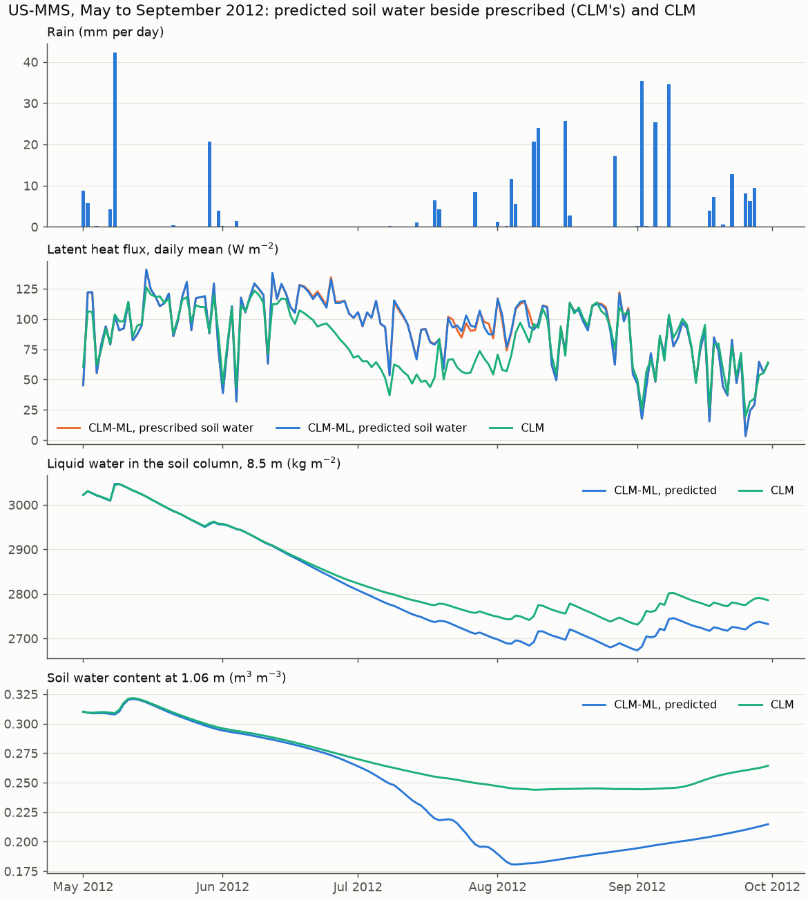

# US-MMS, May to September 2012 (prescribed soil water)

Morgan-Monroe State Forest, Indiana (AmeriFlux US-MMS, a PLUMBER2 site): a rain-fed
deciduous broadleaf forest. This run is the baseline for predicted soil water: soil water
prescribed from a CTSM 5.4 run, so that a run with predicted soil water can later be compared
with it, with CLM and with the measurements. 2012 is the year of the Midwest drought: 2 mm of
rain in June and 20 mm in July, then a wet August and September. The period and the 1-hour
step are decision 135.

A tower other than CHATS7 is an experiment folder, not a built-in compset (decision 13). The
four files were written by `clm-ml new` and are complete; run with `clm-ml run
experiments/us_mms_2012` (an hourly output stream of every variable; 3 minutes on one CPU
of Derecho).

## The tower (`domain.yaml`)

- Location 39.3232 N, 86.4131 W; forcing at 48 m; canopy height 27 m; root biomass
  500 g m⁻²; leaf and stem area profiles of the PFT (broadleaf deciduous temperate tree).
  Heights, roots and profiles as CLM-ml v2's `TowerDataMod`.
- Soil from the CTSM 5.4 PLUMBER2 surface dataset
  (`surfdata_1x1_PLUMBER2_US-MMS_hist_2000_16pfts_c251023.nc`), the soil of the CLM run whose
  soil water is prescribed: sand, clay and organic matter of its 10 layers
  (`texture: {given_as: layers}`, decision 137), mapped to the soil levels as CTSM does, so
  that porosity, saturated suction, `b` and saturated conductivity equal CLM's at every
  level; colour class 12; bedrock at 20.34 m (below the soil column). CLM-ml v2's table
  gives the class "clay", colour 15 and bedrock at 50 m instead.
- For predicted soil water, from the same dataset: `FMAX` 0 (no saturated fraction), slope
  0.51°.
- CO₂: CLM's (`run.yaml` `forcing.co2`, the DATM file
  `data/input_files/ctsm5_4/fco2_datm_globalSSP3-7.0_simyr_1750-2501_CMIP6_c201101.nc`,
  linear in time: 392.8-393.6 ppm over the period), equal to CLM's monthly `PCO2`.
- `model.yaml`: a 1-hour step (`numerics.step_seconds: 3600`) and `canopy_layers.max_layers:
  100` (96 layers of 0.5 m up to 48 m; Fortran's `nlevmlcan` is 100). `params.yaml`: CLM6.

## Inputs

- Forcing: `data/input_files/tower-forcing/US-MMS/2012-05.nc` ... `2012-09.nc`, hourly, UTC,
  cut from CTSM's `CTSM_DATM_US-MMS_1999-2014.nc` by `convert_plumber2.py` in that folder
  (the forcing CLM was run with).
- CLM history: `data/input_files/ctsm5_4/US-MMS/US-MMS_ctsm54_SP.clm2.h2.2012-05-01-00000.nc`
  (`ELAI`, `ESAI`, `H2OSOI`, `TSOI`, hourly, double precision), cut by `subset_history.py`
  in that folder from the CLM run below.

## The CLM run (on Derecho, outside the repository)

`ctsm5.4.004`, satellite phenology (LAI from the PLUMBER2 stream), `CLM_USRDAT` with the
user mods `PLUMBER2/US-MMS`, 1-hour step:

- `/glade/work/linnia/cases/US-MMS_ctsm54_SP.spinup`: cold start, 48 years cycling the
  1999-2014 forcing. Soil water is in equilibrium after the first cycle (total liquid water of
  the same forcing year equal to 0.01 mm between cycles 2 and 3); deep soil temperature still
  warms by 0.2 K (1 m) to 0.9 K (7 m) per cycle.
- `/glade/work/linnia/cases/US-MMS_ctsm54_SP.transient`: 1999-2014 from the spin-up, history
  `h2` hourly in double precision (the CLM-ML inputs and the soil water fields). Its `h2`
  file is kept in `/glade/work/linnia/phase10_us_mms/clm_runs/`.
- In `ctsm5.4.004` the forcing stream is `PLUMBER2.US-MMS`; the user mods' lines for
  `CLM_USRDAT.PLUMBER2` are ignored, so the cases set `datafiles`, `taxmode` and `dtlimit`
  for `PLUMBER2.US-MMS` in `user_nl_datm_streams`. The forcing file is not in Derecho's shared
  input data; it is in `/glade/work/linnia/phase10_us_mms/inputdata/`, downloaded from the
  CESM input data server.

## With predicted soil water

`clm-ml run experiments/us_mms_2012 --set model.soil.water=predicted` moves the soil water
with CLM's soil hydrology, starting from CLM's soil water on 1 May. The runs of 2026-11-25
(commit `cfb2b56`; outputs in `/glade/work/linnia/phase10_us_mms/us_mms_2012_10_8_prescribed`
and `..._predicted`, analysis scripts in `.../analysis_10_8`) beside the CLM run:

Monthly means (latent heat and sensible heat in W m⁻², GPP in µmol m⁻² s⁻¹):

| 2012 | Latent heat: prescribed / predicted / CLM | Sensible heat | GPP |
|---|---|---|---|
| May | 101.9 / 101.9 / 101.1 | 40.6 / 40.5 / 42.3 | 10.5 / 10.5 / 9.4 |
| June | 109.5 / 109.2 / 96.1 | 49.5 / 49.8 / 60.7 | 10.5 / 10.5 / 8.0 |
| July | 92.1 / 92.4 / 58.6 | 50.5 / 50.3 / 80.2 | 8.7 / 8.7 / 4.4 |
| August | 97.1 / 96.6 / 90.3 | 33.6 / 34.0 / 38.7 | 9.4 / 9.4 / 7.5 |
| September | 60.8 / 60.8 / 63.9 | 30.9 / 30.9 / 27.1 | 7.5 / 7.5 / 6.9 |

Water over the five months (mm), CLM-ML with predicted soil water / CLM: rain 361.5 (both);
reaching the ground 342.5 / 340.4; transpiration 447.2 / 381.9; ground evaporation 21.0 /
30.0; evaporation of intercepted water 19.2 / 21.6; surface runoff 0 / 0 (`FMAX` is 0);
drainage 165.6 / 166.2; change of the soil's liquid water −291.3 / −237.6.

- The hydrology behaves as CLM's: the same drainage, the same water table (6.82 to 7.51 m),
  the same pond after the storm of 7 May (22.3 mm against CLM's 22.2, present in the same
  125 hours). The water balance closes to 1.4e-12 mm per step; the Richards solver takes
  one sub-step in 55 % of the steps, 2.1 on average and at most 28.
- CLM-ML's fluxes barely change with predicted soil water (latent heat within 0.5 W m⁻² in
  every month): its soil water stress factor stays 1 through the drought, with CLM's soil
  water and with its own.
- CLM-ML's trees take 65 mm more water than CLM's (most of it in June and July, when CLM's
  transpiration falls by 40 % and CLM-ML's by 14 %), so its soil ends 54 mm drier, between
  0.5 and 2 m: 0.215 against 0.264 m³ m⁻³ at 1.06 m on 30 September. This is the
  canopy's difference from CLM, not the hydrology's (see the known daytime latent heat
  bias).

The whole of 2012 (from 1 January, `.../us_mms_2012_year_predicted`): the balance closes
(1.6e-12 mm per step), drainage 379.8 mm against CLM's 380.0, transpiration 575.7 against
495.8, the soil's liquid water at the end of the year 39 mm below CLM's. There is no snow
or frozen soil water in CLM-ML (CLM has 5.5 mm of snowfall and up to 59 mm of soil ice
that winter). A run cannot yet cross from 31 December to 1 January (open item O92).

Measurements (soil moisture, fluxes): not obtained; the phase compares with CLM only
(decision 136).
